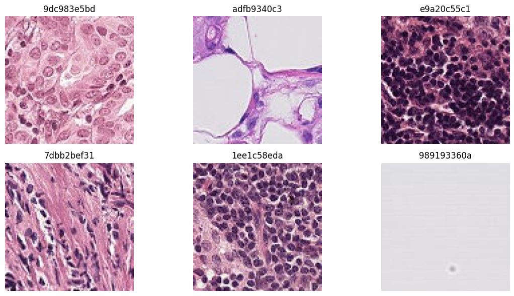
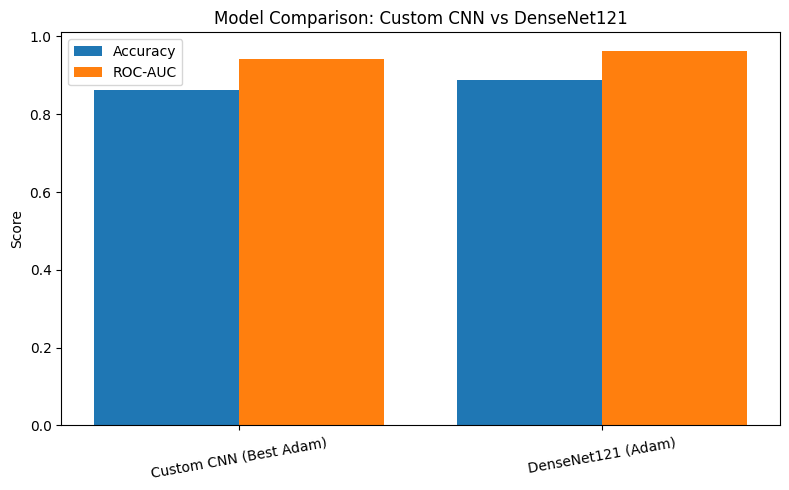
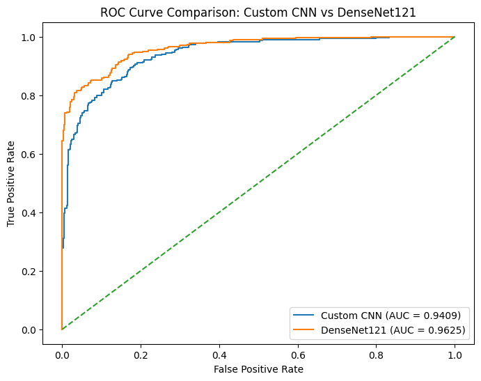
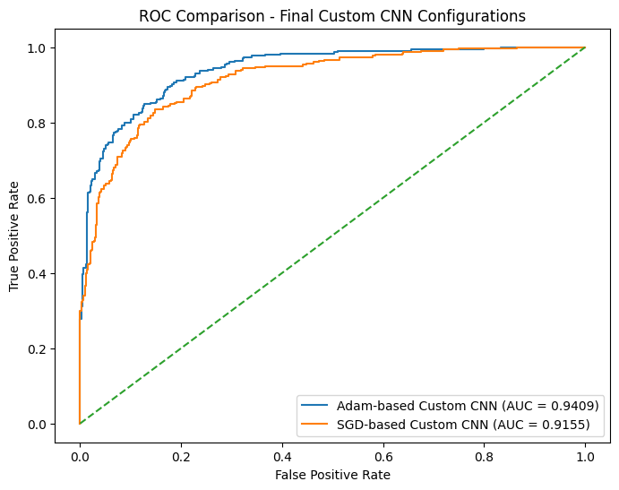
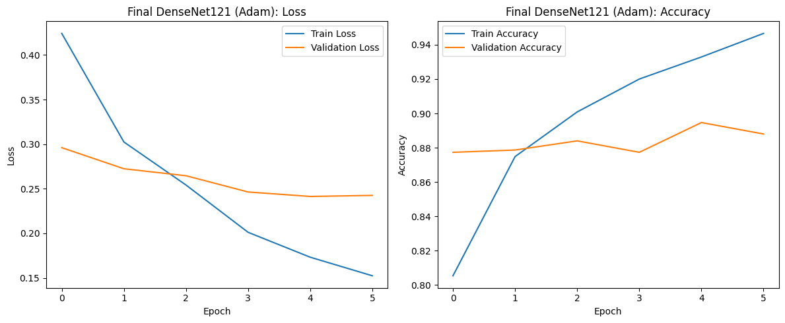

<div align="center">

# Histopathologic Cancer Detection

Binary classification of metastatic cancer in H&E stained tissue patches.<br>
DenseNet121 achieves **89% accuracy** and **ROC-AUC 0.9625** on a 5,000-image subset of the Kaggle dataset.

[](https://pytorch.org)
[](https://www.kaggle.com/c/histopathologic-cancer-detection)
[](LICENSE)

</div>

<br>



> [!NOTE]
> Images are 96×96 pixel patches from lymph node sections stained with Hematoxylin and Eosin (H&E). Hematoxylin stains nuclei blue; eosin stains cytoplasm pink. Cancerous tissue shows irregular, densely packed nuclei — a subtle pattern that transfer learning captures significantly better than a custom CNN trained from scratch.

## Benchmarks

| Model | Val Accuracy | ROC-AUC | Optimizer | Scheduler |
|:--|:--:|:--:|:--:|:--:|
| Custom CNN | 86.27% | 0.9409 | Adam | StepLR |
| Custom CNN | ~84% | 0.9155 | SGD | CosineAnnealingLR |
| **DenseNet121** | **~89%** | **0.9625** | **Adam** | **StepLR** |

DenseNet121's dense connections enable feature reuse that is especially effective for the fine-grained texture differences between cancerous and healthy tissue.

<table>
<tr>
<td></td>
<td></td>
</tr>
<tr><td align="center">Accuracy & ROC-AUC comparison</td><td align="center">ROC curves — Custom CNN vs DenseNet121</td></tr>
</table>

## Experiments

Both architectures were evaluated under four conditions: two optimizers (Adam, SGD) × two schedulers (StepLR, CosineAnnealingLR), with hyperparameter tuning over learning rate and weight decay for each.

<table>
<tr>
<td></td>
<td></td>
</tr>
<tr><td align="center">Custom CNN — Adam vs SGD</td><td align="center">DenseNet121 training curves</td></tr>
</table>

## Setup

| Item | Detail |
|:--|:--|
| Dataset | [Kaggle — Histopathologic Cancer Detection](https://www.kaggle.com/c/histopathologic-cancer-detection) |
| Subset used | 5,000 images (stratified) for efficient experimentation |
| Image size | 96×96 pixels, RGB, H&E staining |
| Task | Binary classification: cancerous (1) vs healthy (0) |
| Loss | Binary Cross-Entropy with Logits |

## Quick Start

```bash
git clone https://github.com/VenuBandi/histopathologic-cancer-detection
cd histopathologic-cancer-detection
pip install -r requirements.txt
jupyter lab notebooks/Histopathologic_Cancer_Detection.ipynb
```

Download the dataset from [Kaggle](https://www.kaggle.com/c/histopathologic-cancer-detection) and place the extracted `train/`, `test/`, and `train_labels.csv` in a `data/` folder before running.

## Stack

| Layer | Tools |
|:--|:--|
| Deep Learning | PyTorch, torchvision (DenseNet121) |
| Data Handling | Pandas, PIL, scikit-learn |
| Evaluation | ROC-AUC, Accuracy, Confusion Matrix |
| Visualization | Matplotlib |

## License

MIT
